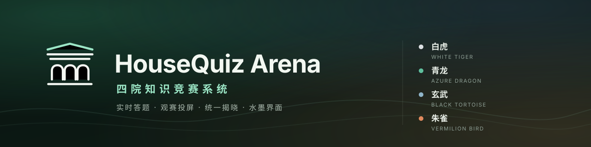
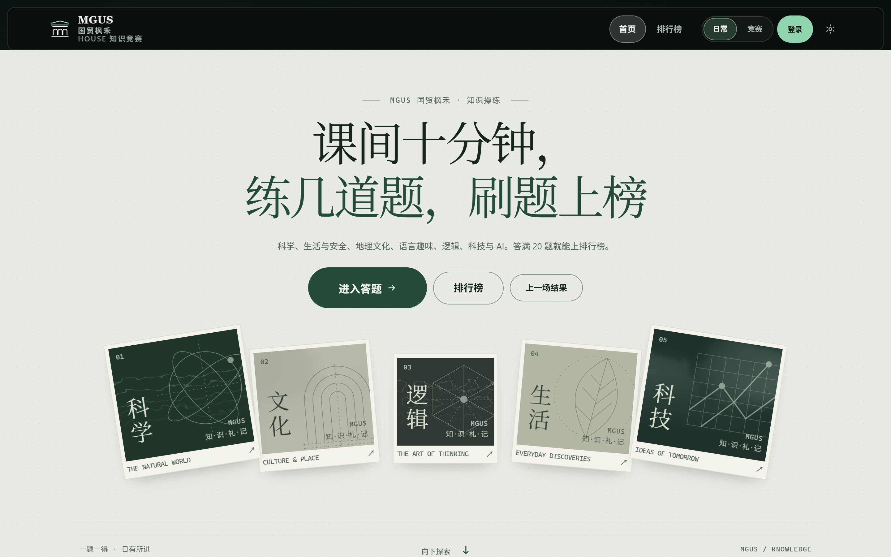
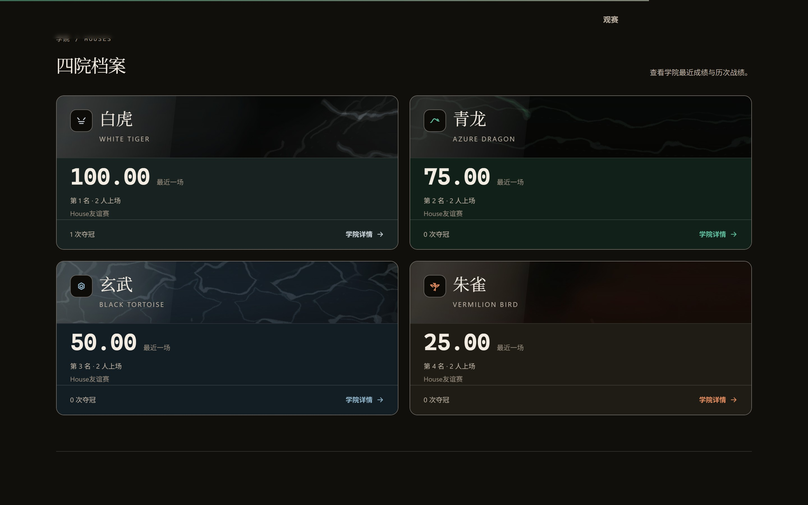
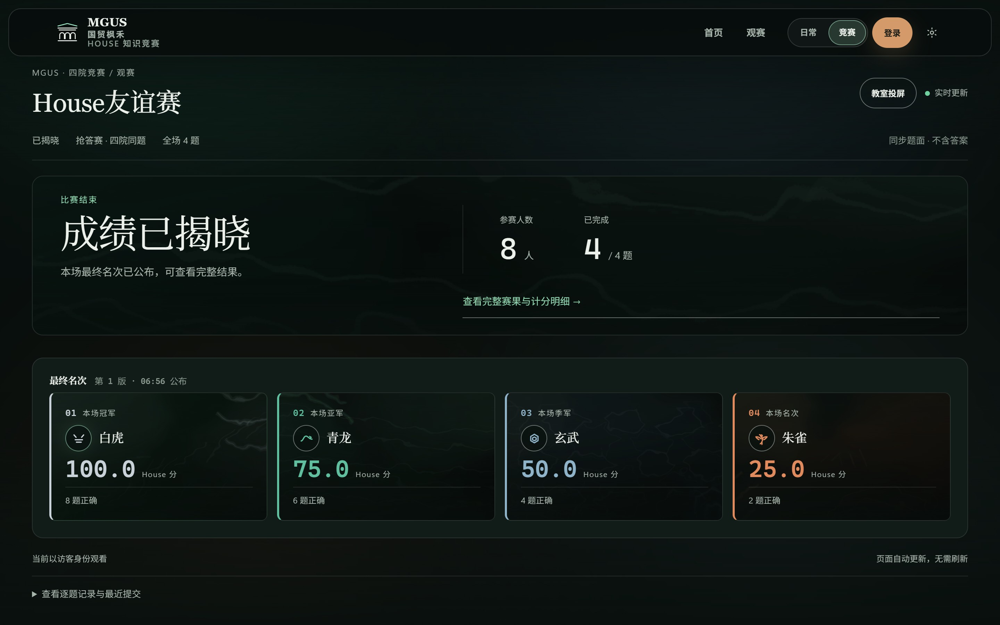
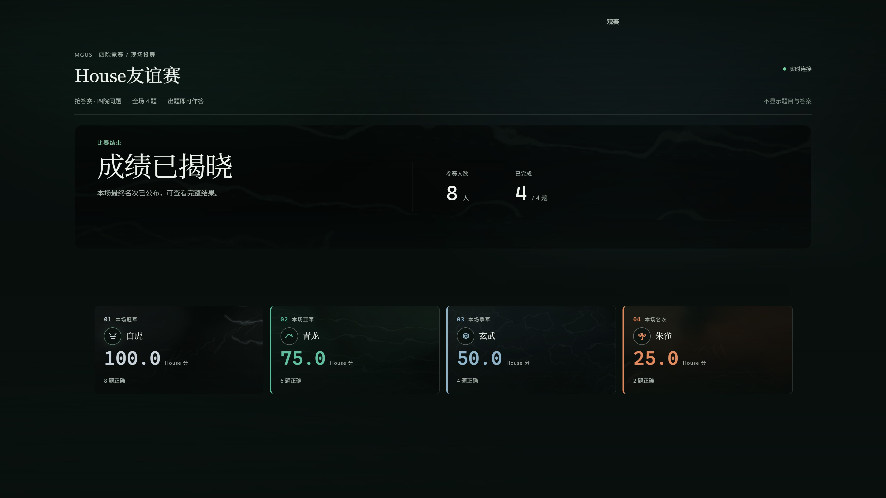
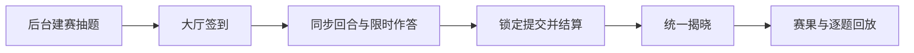
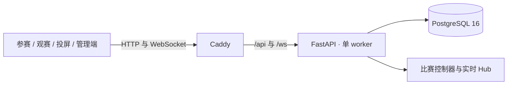

<p align="center">
  
</p>

<p align="center">
  
  <a href="../../actions/workflows/ci.yml"></a>
  
  
  
  
  
</p>

<p align="center">
  <b>开箱即用的校园 House 竞赛系统</b><br>
  内置样例题库 · 服务端智能评分 · 水墨质感前端 · 完善用户体系<br>
  四院同场作答 · 匿名观赛 · 教室投屏 · 统一揭晓 · 日常练习
</p>

---

## 界面预览



| 四院档案与历史成绩 | 观赛与统一揭晓 |
| :---: | :---: |
|  |  |



## 核心能力

| 能力 | 说明 |
| --- | --- |
| **开箱即用** | 一条 `docker compose up -d --build` 完成镜像构建、数据库迁移、四院与样例数据初始化；无需手动建表或改配置 |
| **内置题库** | 预置 71 道样例题（41 道竞赛 / 30 道日常），覆盖科学、生活与安全、地理文化、语言、逻辑与校园知识；支持 CSV 导入导出、题目版本、审核、去重与多题池 |
| **智能评分** | 服务端判定截止时间，正确率 / 速度 / 参与度权重可调；抢答赛与接力赛两套赛制，成绩版本化、定时揭晓、逐题回放 |
| **前沿前端** | 水墨材质、滚动叙事、鼠标追视、View Transitions 页面过渡；首页、答题、观赛、投屏与管理端均有独立布局，并适配手机、桌面与大屏 |
| **完善用户系统** | 注册、登录、角色权限（管理员 / 智囊 / 学生）、House 归属、单活跃会话、换机交接码、强制改密、封禁与操作审计 |

## 快速开始

需要 Docker 与 Docker Compose，其他依赖都在容器内。克隆或下载本仓库后，在仓库根目录执行：

```bash
cp .env.example .env
# 编辑 .env：为 MGUS_DB_PASSWORD 与 MGUS_SEED_ADMIN_PASSWORD 设置不同的强随机密码
docker compose up -d --build
```

Windows PowerShell 使用 `Copy-Item .env.example .env`。启动后访问 [http://localhost:8080](http://localhost:8080)：`init` 服务会自动执行 Alembic 迁移并写入四院、管理员、演示账号与待审核样例题；`api` 通过健康检查后 `web` 才会启动。

首次登录后请在后台审核样例题，再创建比赛。

| 账号 | 口令 | 用途 |
| --- | --- | --- |
| `admin` | `.env` 中的 `MGUS_SEED_ADMIN_PASSWORD` | 管理员，首次登录后强制改密 |
| `demo_<house>_01..05`、`demo_advisor_<house>` | `demo-pass-2026` | 演示账号，口令随源码公开 |

> **对外开放前必须封禁全部 `demo_*` 账号。** 默认 Compose 只把端口绑定在 `127.0.0.1`，仅适合本机体验；公网或校园网部署请先完成 [部署检查](docs/deployment.md)。

常用命令：

```bash
docker compose ps                 # 容器状态
docker compose logs -f api web    # 查看日志
docker compose up -d --build      # 更新代码后重建
docker compose down               # 停止，保留数据库卷
```

## 比赛流程



选手在答题端看到题面与倒计时；观赛端与投屏端只拿到进度、题号与揭晓后的成绩，不会提前获得答案。比赛状态由服务端状态机推进，提交与主持命令都带幂等键，重复请求不会重复计分。

## 系统架构



| 层 | 技术 | 职责 |
| --- | --- | --- |
| 前端 | React 18、TypeScript、Vite、TanStack Query、ECharts | 参赛、观赛、投屏、练习与管理界面 |
| API / 实时 | FastAPI、Uvicorn、原生 WebSocket | 业务 API、比赛状态机、进度广播 |
| 数据 | PostgreSQL 16、SQLAlchemy 2 async、Alembic | 题库、成绩、会话、审计与迁移 |
| 入口 | Caddy | 静态资源与 `/api`、`/ws` 反向代理 |

比赛控制器、WebSocket Hub、限流计数与在途提交计数都驻留在同一个 API 进程，因此当前版本固定 **单 worker、单 API 实例**；应用会在启动时拒绝多 worker 配置。详见 [架构说明](docs/architecture.md)。

## 项目结构

```text
frontend/                React 页面、交互设计、水墨材质与静态资源
backend/app/             FastAPI 业务模块、状态机、评分与实时服务
backend/migrations/      Alembic 数据库迁移
backend/tests/           122 项后端自动化测试
backend/scripts/seed.py  四院、管理员、演示账号与样例题初始化
contracts/               WebSocket 协议说明
deploy/                  Caddy 配置
docs/                    架构、部署与界面截图
.github/workflows/ci.yml 后端测试、前端构建与 Compose 校验
```

## 配置

| 变量 | 必填 | 默认 | 说明 |
| --- | :---: | --- | --- |
| `MGUS_DB_PASSWORD` | 是 | — | PostgreSQL 密码 |
| `MGUS_SEED_ADMIN_PASSWORD` | 是 | — | 首次创建管理员使用的临时密码 |
| `MGUS_ALLOWED_ORIGINS` | 是 | `http://localhost:8080,http://127.0.0.1:8080` | 允许访问的站点来源，多个用逗号分隔 |
| `MGUS_COOKIE_SECURE` | 否 | `false` | HTTPS 部署必须设为 `true` |
| `HOUSEQUIZ_PORT` | 否 | `8080` | 本机访问端口 |

完整配置项见 `backend/app/core/config.py`；不要提交 `.env`、数据库导出、上传文件或任何生产密钥。

## 开发与测试

```bash
# 后端：Python 3.12，测试使用 SQLite + aiosqlite
cd backend
python -m venv .venv
./.venv/Scripts/python -m pip install -r requirements-dev.txt   # Windows
./.venv/Scripts/python -m pytest -q                             # 122 passed

# 前端：Node.js 20
cd frontend
npm ci
npm run build
```

CI 在每次推送与 PR 时执行同样的三组检查：后端测试、前端构建、Compose 配置校验。

## 部署

本机体验使用默认 Compose 即可。对外提供服务时：

1. 在后台封禁全部 `demo_*` 演示账号。
2. 用同机 HTTPS 反向代理把域名转发到 `127.0.0.1:8080`，并支持 WebSocket 升级。
3. 在 `.env` 中设置真实域名并开启安全 Cookie：

```dotenv
MGUS_ALLOWED_ORIGINS=https://quiz.example.edu
MGUS_COOKIE_SECURE=true
```

4. 完成数据库备份与恢复演练，并在真实校园网络上按目标规模压测。

详细步骤、备份与回滚说明见 [部署教程](docs/deployment.md)。

## 已知边界

- 当前实时控制器限定单进程、单实例，不能通过增加 Uvicorn worker 或 API 副本扩容。
- 仓库未包含目标环境压测数据，因此不承诺具体并发人数。
- 题库中的样例题用于演示与初始化，正式使用前应由管理员逐题审核。
- 应用署名与原始页面样式保留；仓库不包含真实用户数据、数据库、上传文件或生产密钥。

## 署名与许可证

By.MapleAutumn🍁『时光流转，愿你能与珍爱之人再度重逢』

[MIT License](LICENSE)
