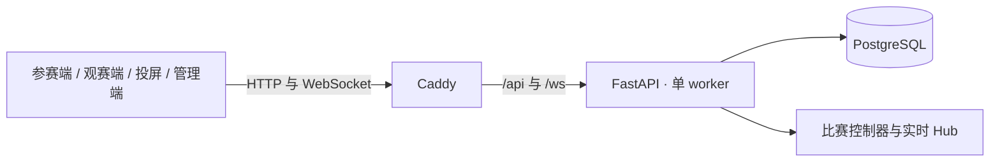

# 架构说明

HouseQuiz Arena 是单体模块化系统，网页由 Caddy 提供，FastAPI 同时处理 HTTP 和 WebSocket，PostgreSQL 保存比赛权威状态。

前端使用 React、TypeScript 与 Vite；TanStack Query 管理 HTTP 数据，WebSocket 接收进度，断线后通过快照恢复。后端的 `accounts`、`questions`、`practice`、`competitions`、`submissions`、`scoring`、`houses`、`assistance`、`audit` 与 `realtime` 模块分别处理身份、题库、练习、比赛、提交、成绩、公开资料、求援、审计与广播。

比赛由服务端状态机推进。答案提交使用幂等键，截止时间以服务端为准；主持命令带版本与命令 ID，重复请求不会重复推进比赛。成绩核算后按配置揭晓，公开视图不会提前展示答案或未发布结果。

实时 Hub、限流与比赛控制器都驻留在同一个 API 进程，因此当前版本只支持一个 Uvicorn worker 和一个 API 实例。扩展到多进程前，需要跨进程广播、共享限流和唯一控制器接管。系统尚无公开的目标环境压测数据，不能据此承诺具体并发人数。
